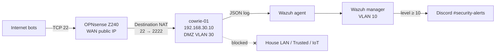
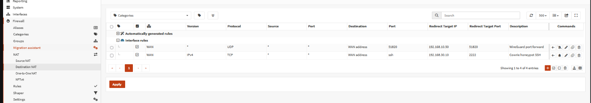
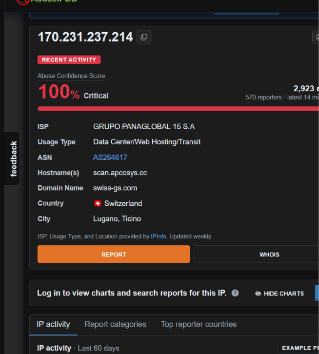
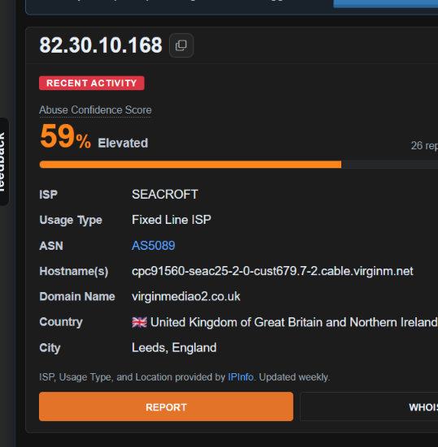
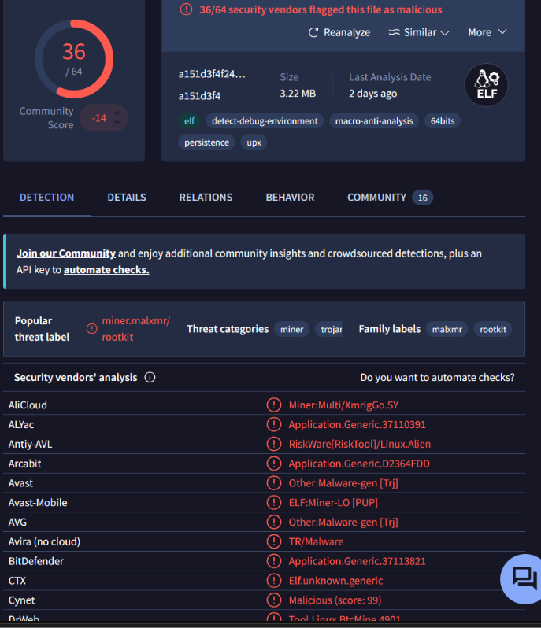
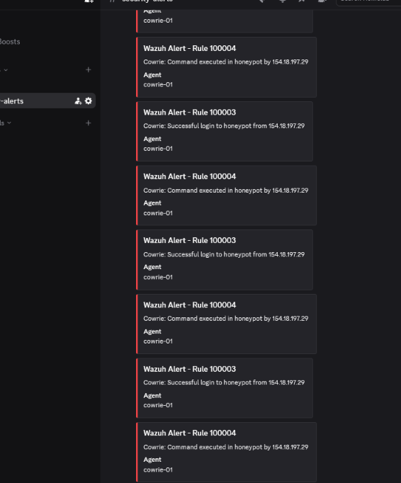
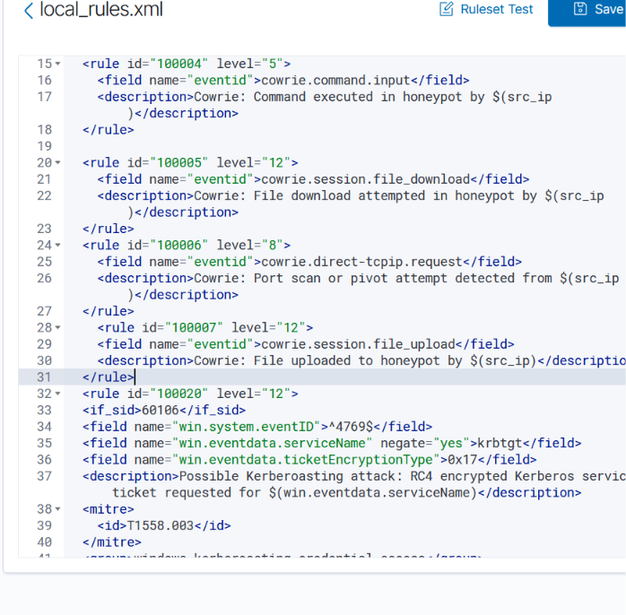

# Cowrie Honeypot Goes Live — First 24 Hours on the Internet

**Date:** October 29–30, 2026
**Result:** ✅ Live — SSH honeypot exposed on WAN port 22; first malware sample captured within 24 hours
**Builds on:** [cowrie-setup.md](cowrie-setup.md) (the original build) and [z240-edge-cutover.md](z240-edge-cutover.md) (DMZ isolation, "Still Open" item)

## Overview

Cowrie, a medium-interaction SSH honeypot, has run in my DMZ (VLAN 30) since May, but only the house network could reach it. With OPNsense upgraded to 26.7 and the DMZ already isolated in both directions, the last step was to put it on the internet: forward WAN port 22 to Cowrie and watch what arrives.

Within one minute the first scanner connected. Within six hours bots were spraying passwords. Within 24 hours one uploaded a Linux cryptominer. This write-up covers the exposure, what the attackers did, how the captured file was identified without touching it, and how the Wazuh alerting had to be retuned once real traffic showed up.

## Topology



## Containment Before Exposure

Opening a port to an attacker-facing service is only reasonable if a compromise can't spread. Checked before the port forward went live:

| Layer | What stops an attacker | Verified |
|---|---|---|
| Fake shell | Cowrie emulates a shell in Python; commands and uploads never run on the real system | By design |
| Container | cowrie-01 is an **unprivileged** LXC — a container escape lands as an unprivileged user on the host | `pct config 108 \| grep unprivileged` → `1` |
| Network | DMZ rules block every private range; the LAN and Trusted VLANs are blocked from the DMZ too (one pass rule lets the uptime monitor check Cowrie) | Firewall rules (Oct 23) |
| Firewall's own SSH | OPNsense's SSH server is disabled, so nothing real listens on WAN 22 | System → Settings → Administration |

Remaining exits from the DMZ are the internet and the Wazuh agent ports — documented as accepted risk.

## The Port Forward

One Destination NAT rule on OPNsense 26.7:

| Field | Value |
|---|---|
| Interface / Version / Protocol | WAN / IPv4 / TCP |
| Source | any |
| Destination | WAN address, port 22 |
| Redirect target | 192.168.30.10 : 2222 |
| Log | on |
| Firewall rule | **Register rule** (auto-creates the matching WAN pass rule) |



Firewall → Log Files → Live View, filtered on 2222, showed the first outside hit about a minute after Apply: an inbound WAN connection on port 22 passed by "Cowrie honeypot SSH" and forwarded into the DMZ. (Direct probes to port 2222 on the public address are correctly blocked — only 22 is forwarded. The repeating DMZ lines from 192.168.10.10 are the uptime monitor.)


## Hour 1 — Scouts

The first visitors connected, read the SSH banner and left without attempting a login. Passive lookups on AbuseIPDB (no contact with the hosts):

| Source | Owner / type | Location | Abuse score |
|---|---|---|---|
| 170.231.237.214 | Hosting provider, hostname `scan.…` | Switzerland | 100% — 2,900+ reports from 570 reporters |
| 82.30.10.168 | Residential cable ISP | Leeds, UK | 59% |
| 176.196.38.213 | Residential fixed-line ISP | Kemerovo, Russia | 100% |

One professional scanning server and two residential connections — most likely compromised home devices conscripted into a botnet.





## Hours 6–7 — Password Spraying

That evening two bots worked the honeypot for about 50 minutes:

- **One targeted `root`**, roughly one guess every 37 seconds. Cowrie accepts root logins, so each guess "succeeded" — and each time the bot ran a single command, `echo xsec`, then disconnected. That's credential validation: confirm the login yields a working shell, record the password, move on.
- **One targeted `ubuntu`**, roughly every 20–30 seconds. Every attempt failed (Cowrie's default user database only admits root).

The guesses were a tour of real-world weak passwords: keyboard walks (`1qaz2wsx`, `!QAZ2wsx#EDC`), `Admin@123` variants, `P@ssw0rd`, and vendor defaults (`Huawei12#$`, `hp@123`).

## Hour 15 — Malware Drop

Overnight a different host logged in and did considerably more:

1. **Fingerprinted the shell** — commands like `echo 'check_…_small_math|'"$((494*651+22))"`, `$$` (PID), positional arguments and a shell function, each tagged with a random marker. This tests whether the shell behaves like real `sh`; honeypots often fail. Cowrie's reply to the arithmetic was malformed, which may have flagged it.
2. **Uploaded a file over SFTP** named `.16` (leading dot = hidden from a plain `ls`).
3. **Tried to make it executable** — `echo '123123' | sudo -S chmod +x /root/.16`, guessing a sudo password, falling back to plain `chmod`.

Then it stopped. Cowrie never executes uploads; it stores them by SHA-256 in its downloads folder.

### Identifying the sample without touching it

The file stayed in the DMZ. Only its hash was searched on VirusTotal (a hash search uploads nothing):

```
a151d3f4f2422531f30a843ffb35479596c86722bb103bdf8591105687f9b125
```

| Attribute | Finding |
|---|---|
| Detection | **36 / 64** engines malicious |
| Type | 64-bit Linux ELF, 3.22 MB, **UPX-packed** |
| Threat label | `miner.malxmr / rootkit` — an XMRig-based Monero miner |
| Behaviour tags | persistence, detect-debug-environment, macro-anti-analysis |
| Last analysis | 2 days earlier — an active campaign |

On a real server this would mine Monero on the victim's CPU, hide itself with a rootkit and survive reboots. Here it sat inert.



## Alert Tuning — The Flood, and a Gap

Cowrie's JSON log was already shipped to Wazuh by the container's agent, and four custom rules from the original build matched it. Real traffic exposed two problems:

1. **Noise.** Successful logins (rule 100003) and every typed command (100004) were level 10 — the Discord threshold. One sprayer produced **1,200+ alerts** in a day, and #security-alerts filled with cards that meant nothing.
2. **A blind spot.** The rules alerted on file *downloads* (`cowrie.session.file_download`, wget/curl) but not *uploads*. The miner arrived by **SFTP upload** (`cowrie.session.file_upload`) — the most important event of the day raised no alert at all.



Fix, in `local_rules.xml` (backup taken first, `wazuh-analysisd -t` to validate, manager restarted):

| Rule | Event | Before | After | Discord? |
|---|---|---|---|---|
| 100003 | `cowrie.login.success` | 10 | **5** | No |
| 100004 | `cowrie.command.input` | 10 | **5** | No |
| 100005 | `cowrie.session.file_download` | 12 | 12 | Yes |
| 100006 | `cowrie.direct-tcpip.request` | 8 | 8 | No |
| **100007** | **`cowrie.session.file_upload`** | — | **12** (new) | **Yes** |

```xml
<rule id="100007" level="12">
  <field name="eventid">cowrie.session.file_upload</field>
  <description>Cowrie: File uploaded to honeypot by $(src_ip)</description>
</rule>
```



**Verification:** Discord stayed silent after the restart while the login-alert count in `alerts.json` kept climbing (1,347 → 1,348 a minute apart) — every event is still recorded and searchable in Wazuh; only malware delivery reaches the phone. A separate test (synthetic SSH brute-force via `logger`) confirmed level-10 alerts still push to the phone end to end.

## Lessons

- **Contain first, expose second.** Unprivileged container + DMZ that can't reach private ranges + firewall SSH off made opening port 22 a low-risk change.
- **Exposure is discovered in minutes.** First scanner within a minute; credential spraying within hours; malware within a day.
- **Bots validate before they exploit.** The `echo xsec` loop and the shell fingerprinting are reconnaissance; the payload came from a different host later.
- **Identify malware by hash, not by handling it.** The sample never left the DMZ.
- **Alert on what matters, record everything.** Level 10 for every honeypot login turns the alert channel into noise that hides real events. Logins and commands belong in the SIEM; delivery of a payload belongs on the phone.
- **Real traffic finds rule gaps that tests don't.** The upload rule was missing for months because nothing had ever uploaded.

## Still Open

- Suricata on the Z240's Intel NICs feeding Wazuh (network-level view of the same attackers).
- Log retention for Cowrie (logs kept since March, ~275 MB; revisit a 90-day cleanup).
- Confirm the first upload/download alert reaches Discord and the phone.
