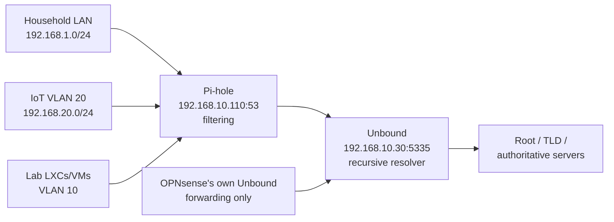

# Pi-hole + Unbound: Self-Hosted Recursive DNS

## Overview
Pi-hole handles network-wide DNS filtering and ad blocking for the whole household. Unbound runs beside it as a recursive resolver, so DNS is answered by querying the root and authoritative servers directly instead of relying on an upstream provider like Google (8.8.8.8) or Cloudflare (1.1.1.1).

## Why This Setup
A third-party DNS provider sees and can log every lookup a network makes. With Unbound resolving recursively, no single outside provider receives the full query stream, and Pi-hole gives visibility into what every device is asking for — useful both for privacy and as a security signal.

## Architecture



| Component | Host | Address | Role |
|-----------|------|---------|------|
| Pi-hole | LXC 101 (Debian 12) | 192.168.10.110 (VLAN 10) | DNS server for every client; blocklists; local DNS records for all `*.meadows-lab.com` names |
| Unbound | LXC 102 (Debian 12) | 192.168.10.30:5335 (VLAN 10) | Recursive resolver; Pi-hole's only upstream |
| OPNsense Unbound | Firewall | 192.168.10.1 | The firewall's own lookups — forwards to unbound-01:5335 |

Both containers originally lived on the flat household network (192.168.1.x) and were moved onto the Trusted VLAN during the VLAN migration.

## How Clients Reach Pi-hole
- **DHCP:** OPNsense's Kea DHCP hands out **192.168.10.110** as the only DNS server on the household LAN and the IoT VLAN.
- **IoT firewall rule:** IoT devices may reach Pi-hole on port 53 and nothing else on the private networks — so a smart TV can't bypass filtering by using its own hard-coded resolver inside the lab.
- **Lab containers** use Pi-hole as their nameserver (Pi-hole itself uses 127.0.0.1). The honeypot in the DMZ is the deliberate exception: it uses public resolvers so it never touches internal DNS.
- **Local names:** Pi-hole's Local DNS Records point every `*.meadows-lab.com` service at the Caddy reverse proxy (192.168.10.20), which holds a Let's Encrypt wildcard certificate.

## Unbound Configuration
`/etc/unbound/unbound.conf.d/pi-hole.conf` (excerpt):

```
server:
    port: 5335
    do-tcp: yes
    incoming-num-tcp: 40
    access-control: 192.168.1.0/24 allow
    access-control: 192.168.10.0/24 allow
```

`/etc/unbound/unbound.conf.d/serve-expired.conf`:

```
server:
    serve-expired: yes
    serve-expired-ttl: 86400
    serve-expired-client-timeout: 1800
```

- **Access control** allows only the household LAN and the Trusted VLAN; everything else is refused.
- **`incoming-num-tcp 40`** raised the TCP connection limit after Pi-hole logged repeated "connection prematurely closed" errors from Unbound.
- **Serve-expired** (NLnet Labs' recommended values): Unbound tries the upstream for 1.8 seconds, then answers from cache (up to a day old) instead of returning SERVFAIL. A brief upstream problem no longer takes the whole house offline.
- Always run `unbound-checkconf` before restarting Unbound.

## Testing the Chain

```bash
# Unbound resolves on its own
pct exec 102 -- dig @127.0.0.1 -p 5335 google.com +short
# Pi-hole resolves through Unbound
pct exec 101 -- dig @127.0.0.1 google.com +short
```

On a Windows client, `nslookup google.com` should show `pi.hole` / 192.168.10.110 as the server.

## DNSSEC — Validation On (verified)
Debian's Unbound package ships a root trust-anchor file (`root-auto-trust-anchor-file.conf`), which turns on DNSSEC validation. Confirmed with a pair of test domains — one with a deliberately broken signature, one valid:

```bash
# Broken signature → rejected
pct exec 102 -- dig @127.0.0.1 -p 5335 sigfail.ippacket.stream
#   status: SERVFAIL, ANSWER: 0
# Valid signature → answered and marked authenticated
pct exec 102 -- dig @127.0.0.1 -p 5335 sigok.ippacket.stream
#   status: NOERROR, flags: qr rd ra ad
```

The `ad` (Authenticated Data) flag on the good answer, together with SERVFAIL on the tampered one, shows Unbound is checking signatures — a forged or tampered DNS answer for a signed domain is refused rather than passed to clients. (An item once listed here as a "future improvement" turned out to be on by default.)

## Incidents and Lessons

### March 21 — Internet down, lab fine
External sites failed while every internal service worked. Unbound was healthy on 5335, but a Proxmox housekeeping task had restarted it and two competing Unbound processes stopped it binding properly. A manual `systemctl start unbound` cleared it, and devices recovered once their DNS caches flushed.
**Lesson:** Unbound is a single point of failure for all outside DNS — serve-expired (below) now softens short outages.

### May 26 — Removing the 1.1.1.1 fallback
For months a public resolver had to stay in the chain as a fallback. The cause: Unbound's access control only allowed 192.168.1.0/24, so it refused queries from the firewall on VLAN 10. Adding `192.168.10.0/24` fixed it, and the network has run fully self-hosted DNS since.
**Lesson:** after moving a service to a new subnet, check every access list that names the old one.

### October 2 — "Connection prematurely closed"
Pi-hole logged intermittent TCP errors talking to Unbound. Raising `incoming-num-tcp` to 40 stopped them.

### October 16 — Midnight DNS outage
From 12:10 to 1:45 AM every lookup in the house failed while the WAN link stayed up. Investigation used Pi-hole's FTL database directly:

```bash
pct exec 101 -- pihole-FTL sqlite3 /etc/pihole/pihole-FTL.db \
  "select reply_type, count(*) from queries where timestamp between strftime('%s','2026-10-16 04:00') and strftime('%s','2026-10-16 06:00') group by reply_type order by 2 desc;"
```

Reply type 7 (SERVFAIL) outnumbered every other answer combined — about 14,600 failures. The firewall logged a WAN link drop at 1:39 AM and DNS recovered within minutes, pointing to an ISP-side problem.
**Follow-ups:** serve-expired on Unbound (above) and gateway monitoring on OPNsense, so the next outage leaves latency and packet-loss data behind. (FTL timestamps are UTC.)

### Slow container consoles and journal floods
Both containers showed ~25-second console logins and a flood of AppArmor denials in the host journal. Enabling LXC nesting (`pct set <ID> --features nesting=1`) let systemd-logind run properly and fixed both.

## Monitoring
- **Uptime Kuma** monitors the lab and alerts to Discord.
- **Wazuh agents** on both containers (file integrity, log analysis).
- **Homepage dashboard** shows Pi-hole stats through a dedicated read-only app password.

## Result
Every device in the house — including isolated IoT devices — is filtered by Pi-hole and resolved recursively by Unbound, with no third-party DNS provider in the chain and cache-backed resilience against short upstream failures.
