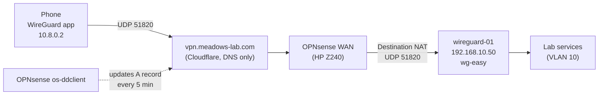

# WireGuard VPN Setup (wg-easy)

**Originally built:** 2026-02-21
**Rebuilt for the new edge router:** 2026-10-13

| Item | Value |
|---|---|
| LXC ID | 109 |
| Hostname | wireguard-01 |
| IP | 192.168.10.50 (VLAN 10, Trusted) |
| OS | Debian 12 |

## Overview

Remote access into the homelab runs on WireGuard, managed through wg-easy in Docker. A dynamic DNS name always points at the home connection. The firewall forwards one UDP port to the WireGuard container. The phone's tunnel is turned on only when away from home.

DNS inside the tunnel goes to Pi-hole, so ad blocking still works on mobile data.



## What changed in October 2026

The original setup depended on the ASUS RT-AC68U:
- its port forward
- its built-in asuscomm.com DDNS name

When the ASUS died in September 2026, both disappeared, and the VPN stopped working.

On Oct 10 an OPNsense box (HP Z240) became the edge router. The VPN was rebuilt around it:

| Piece | Before (Feb 2026) | Now (Oct 2026) |
|---|---|---|
| Edge router | ASUS RT-AC68U | OPNsense on HP Z240 |
| DDNS | ASUS asuscomm.com name | OPNsense os-ddclient → Cloudflare |
| Endpoint | `<asus-ddns-name>:51820` | `vpn.meadows-lab.com:51820` |
| Port forward | ASUS → 192.168.1.110 | OPNsense Destination NAT → 192.168.10.50 |
| LXC address | 192.168.1.110 (flat LAN) | 192.168.10.50 (VLAN 10) |
| Pi-hole | 192.168.1.225 | 192.168.10.110 |

## Network Details

| Item | Value |
|---|---|
| LXC IP | 192.168.10.50 |
| VPN subnet | 10.8.0.0/24 |
| Server VPN IP | 10.8.0.1 |
| Listen port | 51820 (UDP) |
| Web UI | port 51821, served as `wireguard.meadows-lab.com` through Caddy (home or tunnel only) |
| Endpoint | `vpn.meadows-lab.com:51820` |
| DNS for clients | Pi-hole 192.168.10.110 |

## Peers

| Device | VPN IP |
|---|---|
| Server | 10.8.0.1 |
| Phone (A32) | 10.8.0.2 |

The older "Phone" and "Laptop" peers were deleted during the rebuild.

## Prerequisites

- Docker installed on the LXC.
- Nesting enabled on the LXC in Proxmox (Options → Features → Nesting).

## Installation

### 1. Install Docker

```bash
apt update && apt upgrade -y
curl -fsSL https://get.docker.com | sh
```

### 2. Run wg-easy

```bash
docker run -d \
  --name=wg-easy \
  --network host \
  --cap-add=NET_ADMIN \
  --cap-add=SYS_MODULE \
  -e WG_HOST=vpn.meadows-lab.com \
  -e PASSWORD_HASH='<your-bcrypt-hash>' \
  -e WG_DEFAULT_DNS=192.168.10.110 \
  -v ~/.wg-easy:/etc/wireguard \
  --restart unless-stopped \
  <pinned-wg-easy-image>
```

> **`--network host` is required.** Without it, the wg0 interface is created inside Docker's network namespace instead of the LXC, which breaks all routing.

> **The image is pinned on purpose.** This setup uses wg-easy's older environment-variable configuration (`WG_HOST`, `PASSWORD_HASH`, `WG_DEFAULT_DNS`). wg-easy v15 changed how setup works, so pulling `latest` would break it. Stay on the current image until a planned migration.

## Dynamic DNS (OPNsense + Cloudflare)

Without DDNS, the VPN breaks every time the ISP changes the public IP. OPNsense now keeps a Cloudflare record up to date.

**Cloudflare:**
1. Create an API token with **Zone → DNS → Edit**, limited to the one zone. Keep it separate from the token Caddy uses for certificates.
2. Add an A record named `vpn`, **proxy off (grey cloud, DNS only)**. Cloudflare's proxy does not carry WireGuard's UDP traffic.

**OPNsense:**
1. System → Firmware → Plugins → install **os-ddclient**. If it isn't listed, run System → Firmware → Status → **Check for updates** first to refresh the plugin list.
2. Services → Dynamic DNS → General: Enable; backend **native**.
3. Add an account:

| Field | Value |
|---|---|
| Service | Cloudflare |
| Username | `token` |
| Password | the API token |
| Zone | meadows-lab.com |
| Hostname | vpn.meadows-lab.com |
| Check IP method | Interface |
| Interface | WAN |
| Force SSL | ✓ |
| Interval | 300 |

4. The account list shows the current IP and the time of the last update. That is the check that it works.

## Port Forwarding (OPNsense)

**Firewall → NAT → Destination NAT** (the port-forward page):

| Field | Value |
|---|---|
| Interface | WAN |
| Protocol | UDP |
| Destination port | 51820 |
| Redirect target | 192.168.10.50:51820 |
| Description | WireGuard port forward |

A matching WAN pass rule is required: **Allow WireGuard inbound**, UDP to 192.168.10.50:51820. A forward without a pass rule on the arrival interface is dropped.

## Adding a New Peer (Client)

1. Open the wg-easy UI (`wireguard.meadows-lab.com`, from home or through the tunnel).
2. Log in with the admin password.
3. Click **+ New Client** and give it a name.
4. In the WireGuard app: **+** → **Scan from QR code**.
5. Turn the tunnel on and test from mobile data, not home Wi-Fi.

## Using It Day to Day

- The tunnel stays **off at home** and gets turned on in the app only when away.
- On Android, type addresses into **Chrome's address bar with `http://` or `https://`**. The Google app's search box treats an address as a search and returns `DNS_PROBE_FINISHED_NXDOMAIN`.
- `ERR_NETWORK_CHANGED` right after turning the tunnel on just means it's connecting. Reload.
- Lab names such as `https://dash.meadows-lab.com` resolve through the tunnel because client DNS is Pi-hole.

## Split Tunnel (Optional, for a Laptop)

New wg-easy clients default to `AllowedIPs = 0.0.0.0/0`, which sends all traffic through home. For a laptop that should send only lab traffic through the tunnel, edit the tunnel in the WireGuard app and set:

```
10.8.0.0/24, 192.168.10.0/24, 192.168.1.0/24
```

Keep `0.0.0.0/0` on a phone when Pi-hole filtering on all traffic is wanted.

## Verify the Connection

On wireguard-01:

```bash
wg show
```

- A recent **latest handshake** under the peer means the tunnel is up.
- The **endpoint** should be the mobile carrier's IP, not the home IP. That confirms the traffic came in from outside.
- **Transfer** bytes should climb while browsing.

On OPNsense, the Dynamic DNS account list should show the current WAN IP.

## Persistence

- The container restarts automatically (`--restart unless-stopped`).
- nftables rules from the original build are saved to `/etc/nftables.conf` and loaded at boot (`systemctl enable nftables`).
- The OPNsense DDNS account and port forward are part of the OPNsense configuration backup.

## Troubleshooting

### VPN stopped working after a router change (Oct 2026)

**Symptom:** The tunnel won't connect from outside.

**Root cause:** Two things, both tied to the old router:
1. The DDNS name was a feature of the dead ASUS router, so it no longer pointed anywhere.
2. The container's `WG_HOST` still held that dead name, so every client config used it as the endpoint.

**Fix:**
1. Build DDNS on OPNsense (above).
2. Confirm the port forward and WAN rule exist (above).
3. Recreate the container with the new `WG_HOST` and the same image (below).
4. Re-issue client QR codes so the clients pick up the new endpoint.

### Recreating the container safely

`WG_HOST` can't be changed on a running container. Keep the old one until the new one is proven:

```bash
docker inspect wg-easy                  # record image ID, env, volumes, network mode
docker rename wg-easy wg-easy-old
docker stop wg-easy-old
# docker run ... (same settings, same image ID, new WG_HOST)
# after a week or two of working:
docker rm wg-easy-old
```

Peers and keys live in the mounted `~/.wg-easy` folder, so they carry over.

### Nothing loads through the tunnel (Feb 2026 build)

**Root cause:** Two issues combined:
1. Running wg-easy without `--network host` put wg0 inside Docker's network namespace, so the LXC couldn't route traffic through it.
2. Docker sets a DROP policy on the nftables FORWARD chain, which blocked all WireGuard traffic.

**Fix:** Recreate the container with `--network host` (no `-p` port mappings needed), then:

```bash
nft insert rule ip filter FORWARD iifname "wg0" accept
nft insert rule ip filter FORWARD oifname "wg0" accept
nft list ruleset > /etc/nftables.conf
systemctl enable nftables
```

### iptables rules not taking effect

This system has both iptables (nftables backend) and iptables-legacy. Rules added with `iptables` may not reach the kernel, so use `nft` directly.

### os-ddclient missing from the OPNsense plugin list

Run System → Firmware → Status → **Check for updates** to refresh the list, then look again.

## Future

Moving WireGuard from wg-easy into OPNsense's built-in WireGuard would remove a container and keep VPN, firewall and DDNS in one place. Not urgent — the current setup works.
